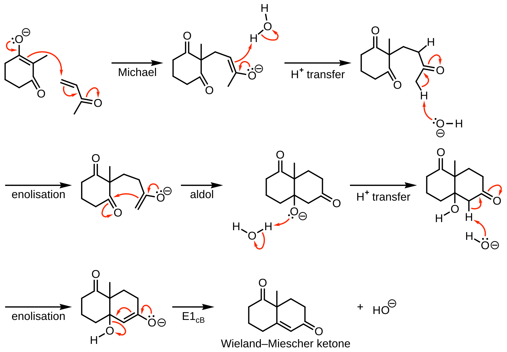
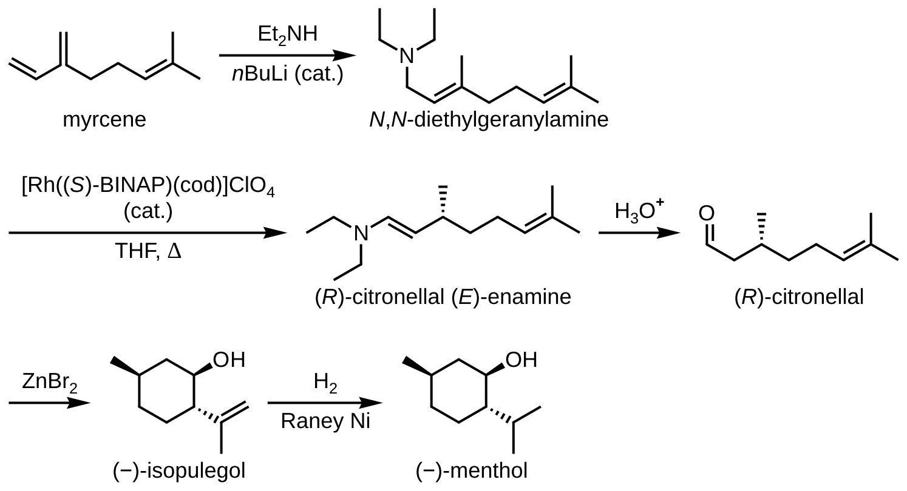
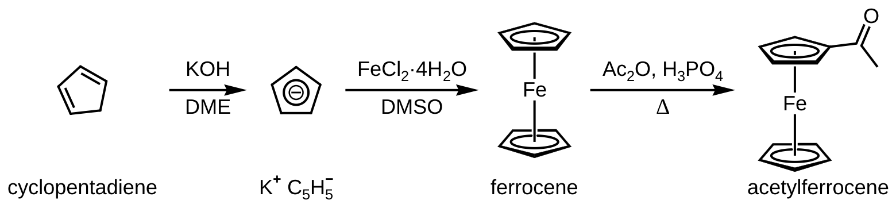
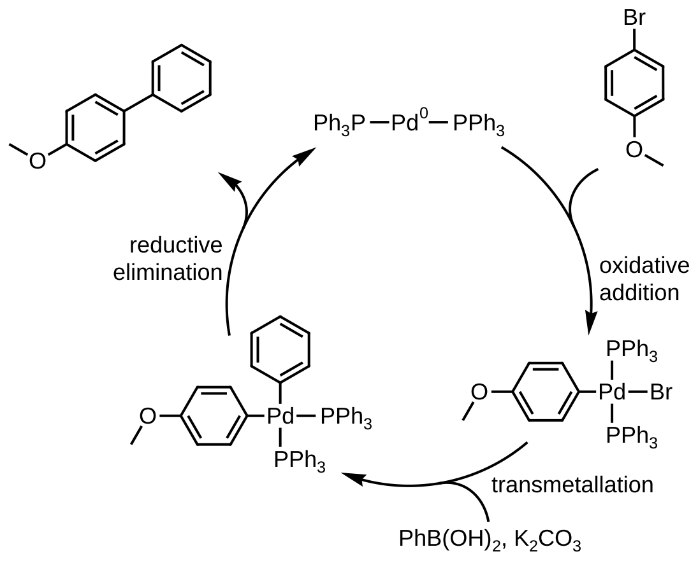
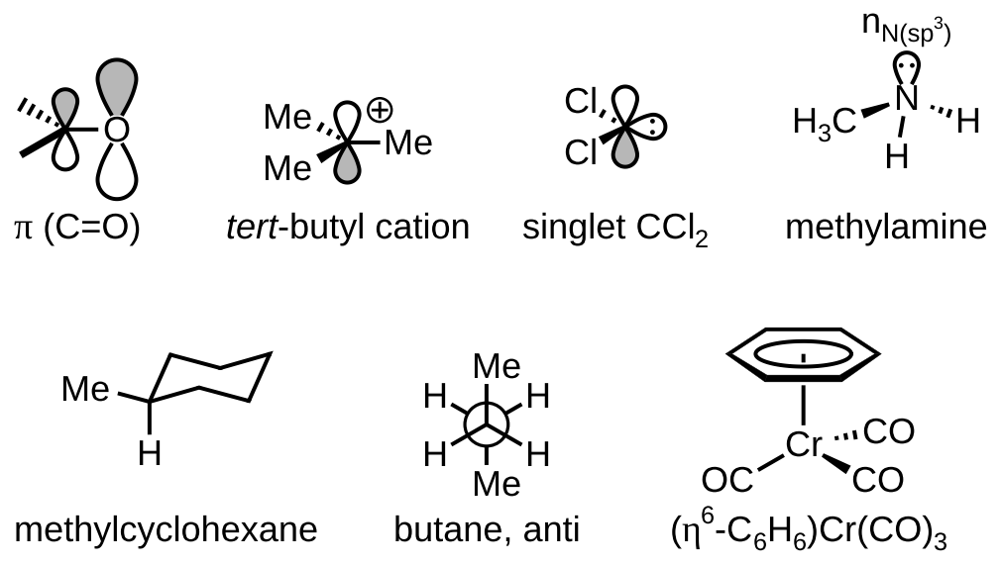

#  bondline

A natural-language chemistry engine for Claude.

Ask Claude for a molecule, a mechanism or a whole synthesis and bondline draws it in one house style, close to what ChemDraw gives you with the ACS 1996 settings. Before a figure is shown, the engine checks it: valences and formal charges, stereocentres against their CIP labels, and whether each curly arrow moves electrons from somewhere sensible to somewhere sensible.

<p align="center">
  <picture>
    <source media="(prefers-color-scheme: dark)" srcset="https://raw.githubusercontent.com/montybwolfe/bondline/main/docs/images/structures-dark.png">
    
  </picture>
</p>

## What it draws

- Structures from a name, SMILES or molfile, bridged and caged natural products included
- Mechanisms with curly arrows, checked one step against the next
- Reaction schemes and catalytic cycles, with reagents and conditions on the arrows
- Organometallics: sandwich complexes, ligand sets, η-bonding
- Orbitals, chairs, Newman projections, transition states and callouts
- Redrawn figures from a photo of your notes or a whiteboard

Output is PNG at 1200 ppi unless you ask for SVG or PDF. Molfiles can be imported, and any structure can be exported as a molfile if you want to finish it in ChemDraw. The same script always gives the same image.

## Usage

Once it's installed, just ask:

- "Draw morphine"
- "Show the mechanism of the Robinson annulation"
- "Draw the catalytic cycle for a Suzuki coupling"

## Examples

### Robinson annulation to the Wieland–Miescher ketone

<p align="center">
  <picture>
    <source media="(prefers-color-scheme: dark)" srcset="https://raw.githubusercontent.com/montybwolfe/bondline/main/docs/images/mechanism-dark.png">
    
  </picture>
</p>

### Takasago synthesis of (−)-menthol

<p align="center">
  <picture>
    <source media="(prefers-color-scheme: dark)" srcset="https://raw.githubusercontent.com/montybwolfe/bondline/main/docs/images/synthesis-dark.png">
    
  </picture>
</p>

### Ferrocene and acetylferrocene

<p align="center">
  <picture>
    <source media="(prefers-color-scheme: dark)" srcset="https://raw.githubusercontent.com/montybwolfe/bondline/main/docs/images/ferrocene-dark.png">
    
  </picture>
</p>

### Suzuki coupling

<p align="center">
  <picture>
    <source media="(prefers-color-scheme: dark)" srcset="https://raw.githubusercontent.com/montybwolfe/bondline/main/docs/images/cycle-dark.png">
    
  </picture>
</p>

### Orbitals, conformations and a half-sandwich complex

<p align="center">
  <picture>
    <source media="(prefers-color-scheme: dark)" srcset="https://raw.githubusercontent.com/montybwolfe/bondline/main/docs/images/gallery-dark.png">
    
  </picture>
</p>

Each of these is a short Python script, and they're all in [docs/showcase](https://github.com/montybwolfe/bondline/tree/main/docs/showcase) if you want to see how a figure is put together.

## Installation

### claude.ai and the desktop app

Download `bondline-<version>.zip` from [Releases](https://github.com/montybwolfe/bondline/releases). Then open the Plugins page (claude.ai/customize/plugins), choose Add › Upload plugin and pick the zip. Uploading a newer zip replaces the version you have.

### Claude Code

```
/plugin install bondline --marketplace montybwolfe/bondline
```

On older versions of Claude Code:

```
/plugin marketplace add montybwolfe/bondline
/plugin install bondline@bondline
```

Or clone the repo and run `claude --plugin-dir path/to/bondline`.

## Requirements

Python 3 with matplotlib and RDKit. If either is missing, it gets installed with pip the first time the plugin runs, and a `bondline.pth` file goes into site-packages so `import bondline` works from any script. Drawing happens offline. The only time it touches the network is when Claude looks a compound up on PubChem or ChEMBL to confirm its structure.

## Tests

```
python3 skills/bondline/tests/run.py
```

This redraws about 200 reference figures and compares them with the stored output. Release notes and known issues are in [CHANGES.md](https://github.com/montybwolfe/bondline/blob/main/skills/bondline/CHANGES.md).

## Licence

MIT
